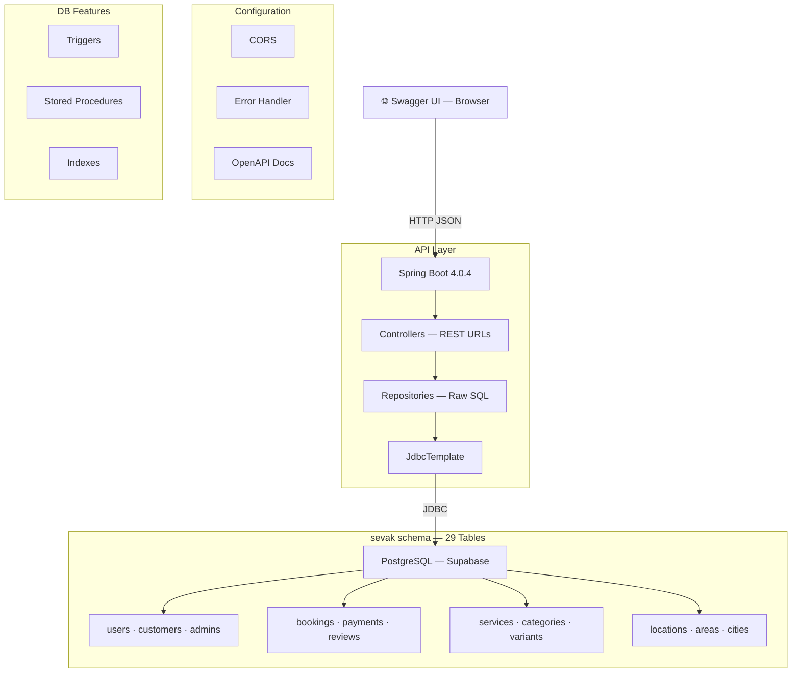

<div align="center">

# ⬡ SEVAK — Service Marketplace

**A React app and REST API built on a BCNF-normalized 29-table PostgreSQL schema**

[](https://github.com/madhavthesiya/sevak/actions/workflows/ci.yml)
[](https://spring.io/projects/spring-boot)
[](https://www.postgresql.org/)
[](https://adoptium.net/)
[](https://sevak.madhavv.me/swagger-ui.html)

[Live Demo](https://sevak.madhavv.me/swagger-ui.html) · [API Docs](https://sevak.madhavv.me/api-docs) · [Health Check](https://sevak.madhavv.me/actuator/health) · [Architecture](#architecture)

</div>

---

## 📋 Overview

**SEVAK** is a hyperlocal home-services marketplace (similar to Urban Company) where customers can discover, book, and review service providers for tasks like electrical work, plumbing, cleaning, and painting.

This project focuses on **database engineering excellence** — featuring a rigorously normalized schema, advanced SQL analytics, a clean REST API, and a web app for customers, providers and admins where **every screen can show the SQL that built it**.

### Highlights

- 🏗️ **29-table BCNF-normalized schema** with mathematical proof of compliance
- 🖥️ **React frontend** with types generated from the API's OpenAPI document, and a CI check that fails if they drift
- 🔎 **"Show the SQL" drawer**: the exact query behind each screen, with an allow-listed `EXPLAIN ANALYZE` for admins
- 📊 **Paginated REST API** showcasing advanced SQL (Window Functions, Derived Tables, STRING_AGG, `generate_series`)
- 🛡️ **Double booking made impossible** by a PostgreSQL exclusion constraint on provider + time range, proven by concurrency tests
- 🔐 **JWT login with roles**, where every `/me` route takes the user from the token, so one user can't ask for another's data
- ♻️ **Safe retries** with `Idempotency-Key`, and a coupon limit that holds under concurrent requests
- 🚦 **Booking status rules stored as data** and enforced by a trigger, with a full audit log
- ⚡ **Stored Procedures** for transactional operations (booking cancellation/confirmation)
- 🔄 **Database Triggers** for automatic rating recalculation on review INSERT/UPDATE/DELETE
- 📦 **Materialized Views** for pre-computed analytics (leaderboard, revenue by city and by category), refreshed in the background
- ⚡ **Measured on 1 million bookings** ([benchmarks](docs/BENCHMARKS.md)): home page 2,334 ms → 8 ms, admin bookings page 514 ms → 2.4 ms, live leaderboard 3,041 ms → 452 ms, with every rewrite checked to return identical rows
- 📖 **Interactive Swagger UI** for live API exploration
- 🌐 **Live deployment** at [`sevak.madhavv.me`](https://sevak.madhavv.me/swagger-ui.html)

---

## 🏛️ Architecture



---

## 🗄️ Database Design

### Entity-Relationship Summary

| Domain | Tables | Description |
|:-------|:------:|:------------|
| **Auth** | 4 | `users`, `customers`, `admins`, `admin_permissions` — ISA hierarchy with enforced roles |
| **Providers** | 5 | `service_providers`, `provider_documents`, `provider_availability`, `provider_services`, `provider_service_areas` |
| **Services** | 3 | `categories`, `services`, `service_variants` — hierarchical catalog |
| **Location** | 4 | `cities`, `areas`, `locations`, `customer_addresses` — BCNF-compliant geo data |
| **Bookings** | 7 | `bookings`, `booking_items`, `booking_status_log`, `booking_status_transitions`, `coupons`, `coupon_redemptions`, `idempotency_keys` |
| **Payments** | 3 | `payments`, `refunds`, `cancellations` — multiple attempts, one success |
| **Reviews** | 3 | `provider_reviews`, `service_reviews`, `complaints` |

### BCNF Compliance

The schema underwent a targeted normalization refactor to resolve a hidden dependency:

```
BEFORE (violated BCNF):
  addresses(address_id, customer_id, area_id, street, landmark, label, latitude, longitude)
  FD: {latitude, longitude} → {area_id, street, landmark}  ← NOT a superkey!

AFTER (BCNF compliant):
  locations(location_id, area_id, street, landmark, latitude, longitude)
    → {latitude, longitude} is now a UNIQUE candidate key ✅
  customer_addresses(customer_id, location_id, label, house_no)
    → label and house_no depend on the whole key ✅
```

📄 Full mathematical proof: [`SEVAK_Normalization_Proof.md`](docs/SEVAK_Normalization_Proof.md)

📊 Relational Schema: [`sevak_dbml.dbml`](docs/sevak_dbml.dbml) (paste into dbdiagram.io)

📝 Top 15 SQL Queries: [`sevak_queries.sql`](api/sql/sevak_queries.sql)

⚡ Benchmarks on 1 million bookings: [`BENCHMARKS.md`](docs/BENCHMARKS.md)

---

## 🔌 API Endpoints

All endpoints are under `/api/v1`. Lists return `{ data, page, limit, total, totalPages }`. Interactive docs are in Swagger UI.

### 1. Services
| Method | Endpoint | Notes |
|:-------|:---------|:------|
| `GET` | `/services?category=&page=&limit=` | The service catalogue |
| `GET` | `/areas` | Every area with its city |

### 2. Providers
| Method | Endpoint | SQL Technique |
|:-------|:---------|:--------------|
| `GET` | `/providers?service=&city=&day=&page=&limit=` | Multi-table JOIN, `ILIKE`, `EXISTS`, ranked by the stored leaderboard score |
| `GET` | `/providers/top?limit=` | Bayesian weighted rating, read from a **materialized view** |
| `GET` | `/providers/{id}` | **Derived table** (rating vs city average) |
| `GET` | `/providers/{id}/reviews` | Paginated JOIN |
| `GET` | `/providers/{id}/slots?from=&days=&minutes=` | `generate_series`, `LATERAL`, range overlap |
| `GET` | `/providers/{id}/jobs?status=` | `LATERAL` join for the latest payment attempt |
| `GET` | `/providers/{id}/earnings?from=&to=` | `SUM`, `COUNT`, `GROUP BY` |

### 3. My account
| Method | Endpoint | Role | Notes |
|:-------|:---------|:-----|:------|
| `POST` | `/auth/register`, `/auth/login` | Public | Returns a 24-hour JWT |
| `GET` | `/me` | Any | The logged-in account |
| `GET` | `/me/bookings`, `/me/bookings/{id}` | Customer | Includes the price breakdown and status timeline |
| `GET` | `/me/payments`, `/me/spending` | Customer | `FILTER` aggregates: paid, upcoming, refunded |
| `GET` `POST` `DELETE` | `/me/addresses` | Customer | Removing is a soft delete; past bookings are unaffected |
| `GET` | `/provider/jobs?status=`, `/provider/earnings?from=&to=`, `/provider/earnings/monthly`, `/provider/profile` | Provider | Street address shown only after accepting |
| `GET` `POST` `DELETE` | `/provider/availability`, `/provider/services` | Provider | Overlapping hours return `409 slot-overlap` |

### 4. Bookings
| Method | Endpoint | Role | What it does |
|:-------|:---------|:-----|:-------------|
| `POST` | `/bookings/quote` | Customer | Live price; checks a coupon without using it up |
| `POST` | `/bookings` | Customer | One transaction: checks, price snapshot, coupon, no double booking. Supports `Idempotency-Key` |
| `POST` | `/bookings/{id}/accept`, `/decline`, `/start`, `/complete` | Provider | Moves through the status rules |
| `POST` | `/bookings/{id}/cancel` | Customer or provider | Customers until 2 hours before; providers until the start |
| `POST` | `/bookings/{id}/payments` | Customer | Mock gateway; `simulate` chooses success or failure |
| `POST` | `/bookings/{id}/review` | Customer | Only after completion, once |
| `POST` | `/bookings/{id}/complaints` | Customer or provider | |

### 5. Admin
| Method | Endpoint | SQL Technique |
|:-------|:---------|:--------------|
| `GET` | `/admin/revenue` | **Materialized view** of a CTE whose **window function** splits each payment across categories |
| `GET` | `/admin/leaderboard?fast=true` | **RANK()** view, or its **materialized view** |
| `GET` | `/admin/complaints` | `STRING_AGG` |
| `GET` | `/admin/complaints/board` | Every complaint, open ones first |
| `GET` | `/admin/providers?status=` | Verification queue, with `STRING_AGG` of documents |
| `GET` | `/admin/city-revenue` | **Materialized view** |
| `GET` | `/admin/bookings?before=&beforeId=&limit=` | **Keyset pagination** |
| `POST` | `/admin/refresh-views` | Also runs on a schedule, guarded by an advisory lock |
| `PATCH` | `/admin/providers/{id}/verification`, `/admin/complaints/{id}` | Verify providers, resolve complaints |
| `POST` | `/admin/refunds/{id}/process` | Completes a refund |
| `POST` | `/admin/queries/{key}/explain` | `EXPLAIN ANALYZE` of an allow-listed read query, with fixed sample values |

### 6. Under the hood
| Method | Endpoint | Notes |
|:-------|:---------|:------|
| `GET` | `/meta/queries/{key}` | The SQL behind a screen. Responses name their query in the `X-Sevak-Query` header |

### Demo accounts
Every demo account uses the password `Demo@1234`. In Swagger UI, log in with `POST /auth/login`, click **Authorize**, and paste the `accessToken`.

| Role | Email |
|:-----|:------|
| Customer | `aarav.sharma@gmail.com` |
| Provider | `ravi.electrician@gmail.com` |
| Admin | `admin.raj@sevak.com` |

### Health and monitoring
| Endpoint | Description |
|:---------|:------------|
| `/actuator/health/readiness` | `503` when the database is unreachable |
| `/actuator/health/liveness` | Whether the app itself is running |
| `/actuator/info` | Build version |
| `/actuator/metrics` | Application metrics |

Every response carries an `X-Request-Id`, which also appears on the matching log lines.

### Error Responses
Errors use [RFC 9457 Problem Details](https://www.rfc-editor.org/rfc/rfc9457), with a stable `type`:

| Status | `type` | When |
|:-------|:-------|:-----|
| `400` | `urn:sevak:error:validation-error` | Invalid parameter or body |
| `401` | `urn:sevak:error:unauthenticated` | Missing, expired or invalid login token |
| `403` | `urn:sevak:error:forbidden` | Your role can't do this |
| `404` | `urn:sevak:error:not-found` | Unknown URL, or a resource that doesn't exist or isn't yours |
| `405` | `urn:sevak:error:method-not-allowed` | Wrong HTTP method |
| `409` | `urn:sevak:error:invalid-state` | Booking is in the wrong status for the action |
| `409` | `urn:sevak:error:slot-taken` | Someone else just booked that time |
| `409` | `urn:sevak:error:idempotency-conflict` | An `Idempotency-Key` was reused for a different request |
| `409` | `urn:sevak:error:slot-overlap` | New working hours overlap hours already set for that day |
| `422` | `urn:sevak:error:business-rule` | Business rule broken, such as provider unavailable |
| `422` | `urn:sevak:error:coupon-invalid` | Coupon expired, used up, already used by you, or below its minimum |
| `429` | `urn:sevak:error:rate-limited` | Too many requests; see `Retry-After` |
| `500` | `urn:sevak:error:internal` | Unexpected error; details only in the server log |

---

## 🚀 Quick Start

### Prerequisites
- Java 21+
- PostgreSQL 16+
- Maven 3.9+

### Local Development

```bash
# 1. Clone the repo
git clone https://github.com/madhavthesiya/sevak.git
cd sevak

# 2. Configure environment
cp .env.example .env
# Edit .env and set your PostgreSQL password

# 3. Set up database
psql -U postgres -c "CREATE DATABASE sevak_db"
# The tables and demo data are created by Flyway when the app first starts.

# 4. Run the API
export DB_PASSWORD=your_password   # Linux/Mac
$env:DB_PASSWORD="your_password"   # Windows PowerShell
cd api && ./mvnw spring-boot:run

# 5. Open Swagger UI
open http://localhost:8080/swagger-ui.html
```

### Docker (One Command)

```bash
docker compose up --build
# API:     http://localhost:8080/swagger-ui.html
# Health:  http://localhost:8080/actuator/health
# If you ran an older version: docker compose down -v  (removes the old database volume)
```

### Web app

```bash
# With the API running on http://localhost:8080
cd web
cp .env.example .env
npm ci
npm run dev          # http://localhost:5173
```

Use the one-click **Customer**, **Provider** or **Admin** login on the home page. After changing the API, run `npm run api:sync` to regenerate the TypeScript types.

---

## ✅ Testing

```bash
cd api && ./mvnw verify   # needs Docker running
```

Tests run against a real PostgreSQL 16 in Docker (Testcontainers), and Flyway builds the database from scratch for every run. Each test is rolled back, so tests can't affect each other. They cover every read endpoint, error responses, stored procedures, triggers, revenue totals, data integrity and customer data isolation. CI runs them on every push, along with a formatting check (Spotless); the coverage report is written to `api/target/site/jacoco`.

```bash
cd web
npm test                # unit tests (Vitest)
npx playwright test     # end-to-end tests; needs the API running
```

```bash
# Benchmarks on about 1 million bookings (needs Docker, about 15 minutes). Results: docs/BENCHMARKS.md
cd api && ./mvnw test -Dtest=QueryBenchmark -Dsurefire.failIfNoSpecifiedTests=false
```

The end-to-end tests drive a real browser against the real API: a customer books, the provider accepts, a coupon reprices the bill, overlapping hours are refused, and a full booking works at phone width. CI also fails if the generated API types no longer match the backend.

The login token is kept in `localStorage` so a refresh or new tab stays signed in. Any script on the page could read it, so the app renders no user-supplied HTML and loads no third-party scripts. Address coordinates are placeholders, because the app has no maps service.

---

## 🛠️ Tech Stack

| Layer | Technology | Purpose |
|:------|:-----------|:--------|
| Runtime | Java 21 (Temurin) | Long-term support JDK |
| Framework | Spring Boot 4.0.4 | REST API + dependency injection |
| Database | PostgreSQL (Supabase) | Managed cloud PostgreSQL |
| DB Access | Spring JDBC (JdbcTemplate) | Raw SQL execution — intentionally chosen over JPA to showcase SQL proficiency |
| Security | Spring Security, JWT, BCrypt | Roles, ownership checks and hashed passwords |
| Rate limiting | Bucket4j | Per-IP limits on login, booking and general traffic |
| Migrations | Flyway | Versioned schema changes; the app builds its own database |
| Testing | JUnit 5, MockMvc, Testcontainers | Integration tests on a real PostgreSQL |
| API Docs | springdoc-openapi 3.0.2 | Auto-generated Swagger UI |
| Frontend | React, TypeScript, Vite | The web app in `web/` |
| Frontend data | TanStack Query, openapi-fetch, openapi-typescript | Server state and generated API types |
| Frontend UI | Tailwind CSS, shadcn/ui, Recharts | Components and charts |
| Frontend tests | Vitest, Playwright | Unit and end-to-end tests |
| Load testing | k6 | 50 virtual users against the API on 1M bookings |
| Container | Docker + Docker Compose | Reproducible deployments |
| API Hosting | DigitalOcean App Platform | Production API deployment |
| DB Hosting | Supabase | Free-tier managed PostgreSQL |

---

## 📁 Project Structure

```
sevak/
├── api/                 # Spring Boot backend
│   ├── src/main/java/com/sevak/api/
│   │   ├── auth/        # Login, tokens, security rules
│   │   ├── common/      # Errors, pagination, rate limiting, request logging, OpenAPI
│   │   ├── catalog/     # Services
│   │   ├── provider/    # Search, profiles, jobs, earnings
│   │   ├── customer/    # Bookings, payments, spending, addresses
│   │   ├── booking/     # Create, lifecycle, payments, reviews, complaints
│   │   └── admin/       # Analytics, verification, refunds, scheduled jobs
│   │                    # Each feature: Controller → Service → Repository, with dto/ records
│   ├── src/main/resources/db/  # Flyway: migration/ (schema, procedures, views), seed/ (demo data)
│   ├── src/test/java/   # Integration tests on a real PostgreSQL
│   ├── sql/             # Top 15 showcase queries, data integrity checks, the 1M-booking generator
│   └── load-test/       # k6 load test
├── web/                 # React frontend
│   ├── src/api/         # Generated types and one typed function per API call
│   ├── src/pages/       # Screens for customers, providers and admins
│   ├── src/sql/         # The "Show the SQL" drawer
│   └── e2e/             # Playwright tests
├── docs/                # Normalization proof, DBML, query notes
└── docker-compose.yml   # Runs the database and the API
```

---

## 📊 Advanced SQL Showcase

This project intentionally uses **Spring JDBC** instead of JPA/Hibernate to demonstrate advanced SQL capabilities:

<details>
<summary><b>Window Function — Provider Leaderboard</b></summary>

```sql
-- v_provider_leaderboard: the live view; mv_provider_leaderboard is its materialized copy
WITH platform AS (SELECT AVG(rating) AS avg_rating FROM provider_reviews),
-- Jobs are counted per provider first. A booking has at most one successful payment, so COUNT(*)
-- needs no DISTINCT; the earlier COUNT(DISTINCT) sorted on disk and took 3,041 ms at 1M bookings, this 452 ms.
jobs AS (
    SELECT b.provider_id, COUNT(*) AS jobs_completed, COALESCE(SUM(p.amount), 0) AS total_revenue
    FROM bookings b
    LEFT JOIN payments p ON p.booking_id = b.booking_id AND p.status = 'success'
    WHERE b.status = 'completed'
    GROUP BY b.provider_id
),
stats AS (
    SELECT sp.provider_id, u.email, ci.city_name, sp.avg_rating, sp.review_count,
           -- Bayesian average: one 5-star review can't beat fifty excellent ones
           CASE WHEN sp.review_count > 0 THEN
               ROUND((5 * pl.avg_rating + sp.avg_rating * sp.review_count) / (5 + sp.review_count), 2)
           END                              AS weighted_rating,
           COALESCE(j.jobs_completed, 0)    AS jobs_completed,
           COALESCE(j.total_revenue, 0)     AS total_revenue
    FROM service_providers sp
    JOIN users u   ON sp.user_id = u.user_id
    JOIN cities ci ON sp.city_id = ci.city_id
    CROSS JOIN platform pl
    LEFT JOIN jobs j ON j.provider_id = sp.provider_id
    WHERE sp.is_active = TRUE
)
SELECT RANK() OVER (ORDER BY weighted_rating DESC NULLS LAST, jobs_completed DESC) AS rank, *
FROM stats
```
</details>

<details>
<summary><b>Derived Table — Rating vs City Average</b></summary>

```sql
SELECT sp.provider_id, u.email, ci.city_name,
       sp.avg_rating AS my_rating,
       city_avg.avg_city_rating,
       CASE
           WHEN sp.avg_rating > city_avg.avg_city_rating THEN 'Above Average'
           WHEN sp.avg_rating = city_avg.avg_city_rating THEN 'Average'
           ELSE 'Below Average'
       END AS comparison
FROM service_providers sp
JOIN users u ON sp.user_id = u.user_id
JOIN cities ci ON sp.city_id = ci.city_id
JOIN (
    SELECT city_id, ROUND(AVG(avg_rating), 2) AS avg_city_rating
    FROM service_providers WHERE avg_rating IS NOT NULL
    GROUP BY city_id
) city_avg ON sp.city_id = city_avg.city_id
WHERE sp.provider_id = ?
```
</details>

<details>
<summary><b>Stored Procedure — Booking Cancellation</b></summary>

```sql
CALL sp_cancel_booking(booking_id, 'Customer changed mind');
-- Atomically: updates status, creates cancellation record,
-- processes refund if payment exists — all in one transaction
```
</details>

---

## 📡 Sample Response

`GET` [`/api/v1/admin/leaderboard`](https://sevak.madhavv.me/api/v1/admin/leaderboard) — uses `RANK()` Window Function:

```json
[
  {
    "rank": 1,
    "providerId": 1,
    "providerName": "Ravi Kumar",
    "cityName": "Ahmedabad",
    "avgRating": 5.00,
    "reviewCount": 1,
    "weightedRating": 4.33,
    "jobsCompleted": 1,
    "totalRevenue": 495.00
  },
  {
    "rank": 1,
    "providerId": 3,
    "providerName": "Amit Joshi",
    "cityName": "Mumbai",
    "avgRating": 5.00,
    "reviewCount": 1,
    "weightedRating": 4.33,
    "jobsCompleted": 1,
    "totalRevenue": 1400.00
  },
  {
    "rank": 3,
    "providerId": 2,
    "providerName": "Sunita Devi",
    "cityName": "Ahmedabad",
    "avgRating": 4.00,
    "reviewCount": 2,
    "weightedRating": 4.14,
    "jobsCompleted": 2,
    "totalRevenue": 4025.00
  }
]
```

> **Note on ranking:** Providers 1 and 3 tie on weighted rating and completed jobs, so both receive rank 1. Because `RANK()` is used instead of `DENSE_RANK()`, rank 2 is skipped and the next provider receives rank 3.
---

<div align="center">

**© 2026 Madhav Thesiya. All Rights Reserved.**

---

**Made by [Madhav Thesiya](https://www.linkedin.com/in/madhavthesiya/)** — If this was useful, drop a ⭐

</div>
